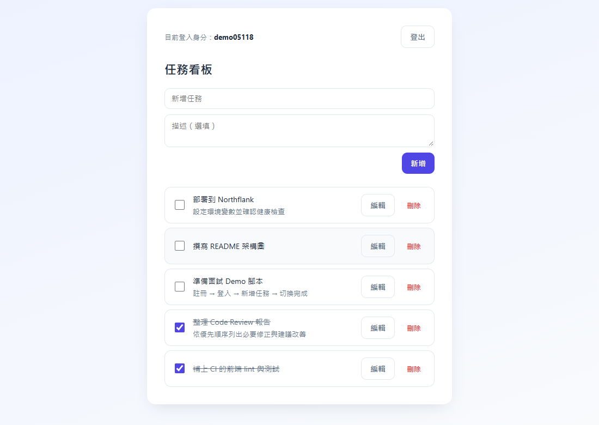
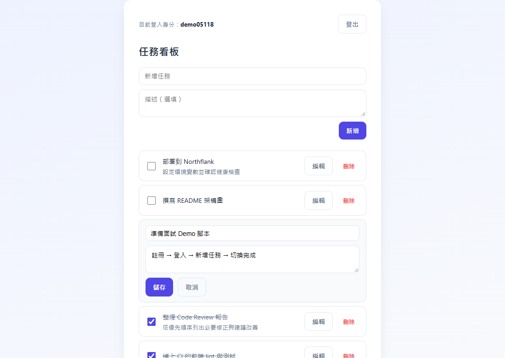
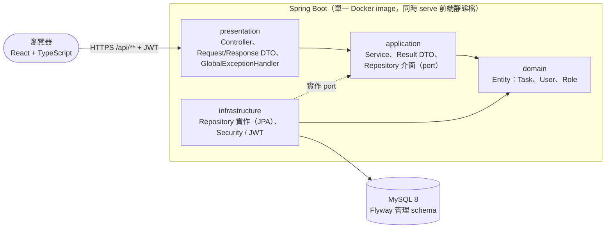
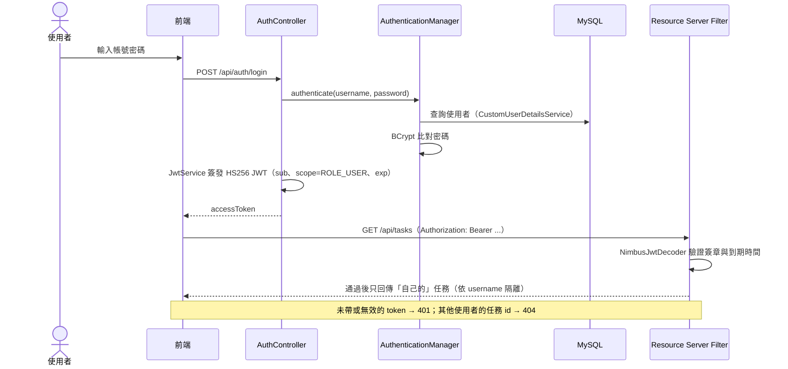
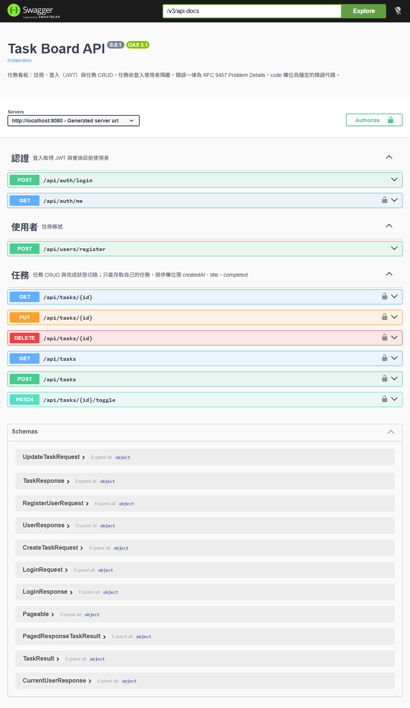

# Task Board

以 **Spring Boot + React** 打造的全端任務管理專案，目標是模擬真實團隊會遇到的後端分層架構、身分驗證、資料庫遷移與測試策略，而不只是做出一個能動的 CRUD。

**線上 Demo**：https://p01--task-board-backend--vnvfqjnzxl2s.code.run/

> 登入頁的「Demo 體驗（免註冊）」可一鍵取得隨機帳號與範例任務，不必先註冊。
**API 文件**：https://p01--task-board-backend--vnvfqjnzxl2s.code.run/swagger-ui.html

## 畫面預覽

| 任務看板 | 編輯任務 |
|---|---|
|  |  |

## 系統架構

依賴只能由外往內（presentation → application → domain）；Repository 介面放在 application，實作放在 infrastructure，因此 Service 不認識 JPA 細節。

## 登入與 JWT 驗證

## API 文件

內建 OpenAPI（springdoc），可直接在 [Swagger UI](https://p01--task-board-backend--vnvfqjnzxl2s.code.run/swagger-ui.html) 試用：先 `POST /api/users/register`、`POST /api/auth/login` 取得 `accessToken`，再按 **Authorize** 貼上。

## 技術棧

- **Backend**：Java 17、Spring Boot 4.1、Spring Security + OAuth2 Resource Server（JWT）、Spring Data JPA、MySQL 8、Flyway、Maven
- **Frontend**：React 19、TypeScript、Vite
- **Infra**：Docker 多階段建置（前端產物由 Spring Boot 直接 serve）、GitHub Actions CI/CD → GHCR → Northflank
- **Testing**：JUnit 5 + Mockito、`@DataJpaTest`、`@WebMvcTest`、`@SpringBootTest`、Testcontainers（MySQL）

## 練習重點

1. **分層架構**：presentation / application / domain / infrastructure 單向依賴；DTO 與 Entity 分離、Repository 介面與實作分離、統一例外處理（`GlobalExceptionHandler` + `ApiException`）。
2. **JWT 驗證**：Spring Security OAuth2 Resource Server + 自簽 HMAC（`NimbusJwtEncoder` / `NimbusJwtDecoder`）、BCrypt、Stateless session，401 / 403 統一回傳 JSON；角色以 `scope` claim 攜帶。
3. **Flyway 遷移**：`V1` ~ `V5` 記錄表結構演進，不手動改 schema。
4. **測試分層**：Unit → JPA slice → Web slice → Full integration → Testcontainers（真 MySQL），各層只驗證自己最有價值的範圍（見 [`backend/TESTING.md`](backend/TESTING.md)）。
5. **API 設計**：RESTful、分頁並以白名單限制可排序欄位、Bean Validation + RFC 9457 統一錯誤格式、依登入者做資料隔離（owner scope）。
6. **CI/CD**：測試通過才 build image，以 commit SHA（非 `latest`）部署到 Northflank 確保版本可追溯，機敏資訊走 GitHub Secrets（見 [`ci.yml`](.github/workflows/ci.yml)）。

## 更多文件

- [本機執行、專案結構與 CI/CD](docs/DEVELOPMENT.md)
- [測試策略](backend/TESTING.md)
